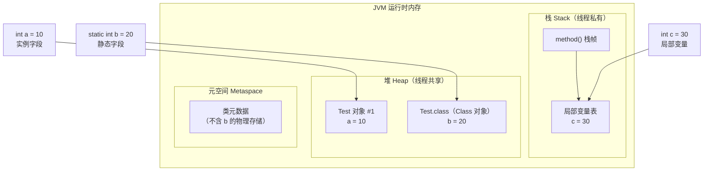
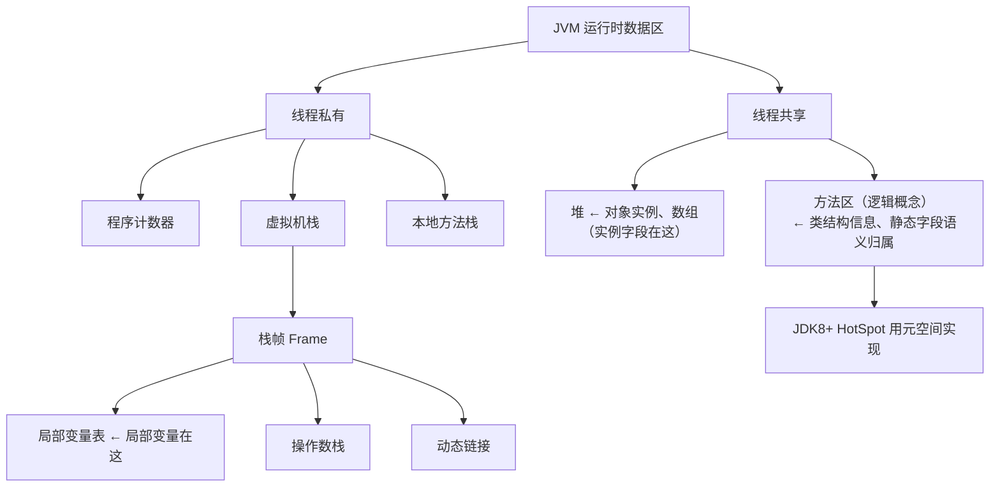
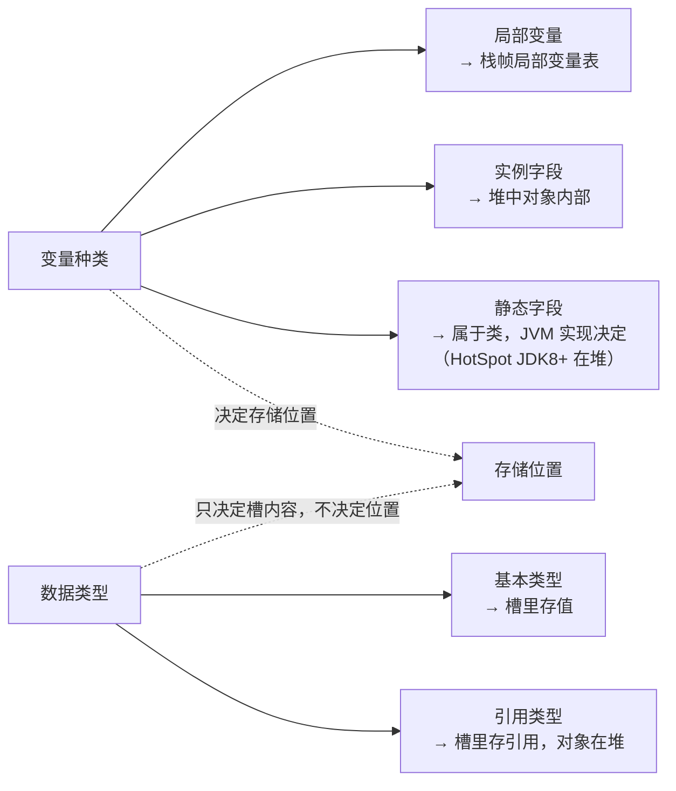
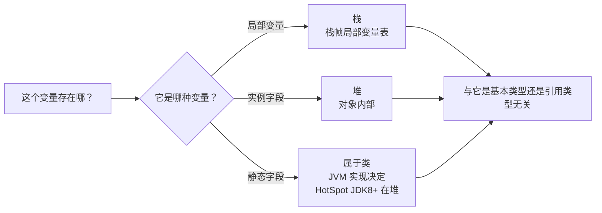

刚学 Java 的时候，几乎所有人都听过这句话：

> 基本数据类型存在栈里，引用数据类型存在堆里。

听着挺顺口，但它是个**简化过头**的说法，甚至会把你带偏。

真正决定一个变量存在哪的，**不是它的数据类型，而是它是哪种变量**。同样一个 `int`，可以是堆里的实例字段，也可以是栈里的局部变量；同样一个引用，变量本身可能在栈里，它指向的对象却在堆里。

一句话记住：

> **局部变量在栈，实例字段在堆的对象里，静态字段属于类、位置由 JVM 实现决定。**

## 一、先看一段代码

```java
public class Test {

    // 实例字段（成员变量）
    int a = 10;

    // 静态字段
    static int b = 20;

    public void method() {
        // 局部变量
        int c = 30;

        // static int d = 40;  // 编译错误！static 不能修饰局部变量
    }
}
```

就三个变量 `a`、`b`、`c`，类型全是 `int`，但它们的存储位置**完全不同**。

很多人看到 `int` 就条件反射"在栈上"，其实只有 `c` 在栈上。`a` 在堆里，`b` 跟着类走。

## 二、画张图，一眼看懂



对照着看：

- `a`（实例字段）→ 堆里 `Test` 对象内部
- `b`（静态字段）→ 跟着 `Class` 对象走（HotSpot JDK8+ 实际在堆里）
- `c`（局部变量）→ 栈帧的局部变量表

**三个都是 `int`，位置却天差地别。** 这就是"基本类型在栈上"站不住脚的地方。

## 三、逐个说清楚

### 1. 局部变量 `int c = 30`：确实在栈上

方法被调用时，JVM 会给它创建一个**栈帧**，栈帧里有一块叫**局部变量表**。`c` 就存在这里。

注意：`c` 在栈上，**不是因为它是个 `int`，而是因为它是局部变量**。就算你写 `String s = "hello"`，这个引用 `s` 本身照样在局部变量表里，只是它指向的对象在堆里。

> 栈里存的是"变量槽"，堆里存的是"对象"。这个区分比"基本类型 vs 引用类型"本质得多。

### 2. 实例字段 `int a = 10`：在堆里

`a` 是成员变量，属于对象。每次 `new Test()`，对象在堆里分配内存，`a` 就是对象内存布局的一部分。

所以这是个典型的反例：**它明明是基本类型，却在堆上。**

### 3. 静态字段 `static int b = 20`：属于类，位置看 JVM 实现

`b` 是静态字段，属于类而不属于任何对象，生命周期跟着类走。

这里最容易说错。很多资料说"静态字段在方法区/元空间"，这话**不够严谨**：

- JVM 规范只规定了方法区**语义上**存类结构信息，没规定物理位置
- JDK7 以前 HotSpot 用"永久代"，在堆里
- JDK8 以后 HotSpot 用"元空间"（在本地内存），但**静态字段实际是跟着 `Class` 对象放在堆里的**

所以严谨的说法是：**静态字段属于类，规范给的是"方法区"语义，物理位置由 JVM 实现决定；HotSpot JDK8+ 实际在堆里。**

### 4. `static int d = 40;` 为什么编译报错？

因为 `static` 的意思是"属于类、类加载时初始化、生命周期跟类走"。

而局部变量的意思是"方法调用时生、方法返回时死"。

两者语义根本冲突——局部变量没有"类"这个归属，`static` 对它毫无意义。所以 Java 语言规范直接禁止，编译器直接报错。这不是 JVM 的限制，是**语法规则**。

## 四、理论支撑：为什么位置由"变量种类"决定

JVM 规范里，运行时数据区大致是这样分的：



要点有两个：

**第一，规范只规定"语义"，不规定"物理位置"。** 所以"静态字段在方法区还是元空间"这种问题，规范层面没有唯一答案，得看具体 JVM 实现。

**第二，变量种类决定归属，数据类型只决定槽里存什么。**



| 变量种类 | 归属 | 存在哪                                |
| -------- | ---- | ------------------------------------- |
| 局部变量 | 方法 | 栈帧的局部变量表                      |
| 实例字段 | 对象 | 堆中对象内部                          |
| 静态字段 | 类   | 由 JVM 实现决定（HotSpot JDK8+ 在堆） |

而数据类型（基本/引用）只影响一件事：

- 基本类型：槽里直接存**值**
- 引用类型：槽里存**引用**，指向的对象在堆

**存储位置看种类，不看类型。** 这就是整件事的核心。

## 五、常见误区

| 你可能听过              | 实际情况                                               |
| ----------------------- | ------------------------------------------------------ |
| 基本类型都在栈上        | 错。实例字段 `int a` 在堆，静态字段 `int b` 在类数据里 |
| 引用类型都在堆上        | 不准确。引用变量本身在栈或对象里，只有它指向的对象在堆 |
| 静态字段在方法区/元空间 | 规范只说方法区语义；HotSpot JDK8+ 静态字段实际在堆     |
| 栈存基本类型，堆存对象  | 混淆了"槽里存什么"和"存在哪"两个问题                   |

## 六、END

记住这张图就够了：



再压缩成一句话：

> **别问"这个类型存在哪"，要问"这个变量是哪种变量"。**
> 局部变量在栈，实例字段在堆的对象里，静态字段属于类、位置看 JVM 实现。基本类型和引用类型的区别，只在于"槽里存的是值还是引用"，不改变它存在哪。

下次再看到"基本类型存在栈上"，你可以笑着补一句：**"那得看它是哪种变量。"**
