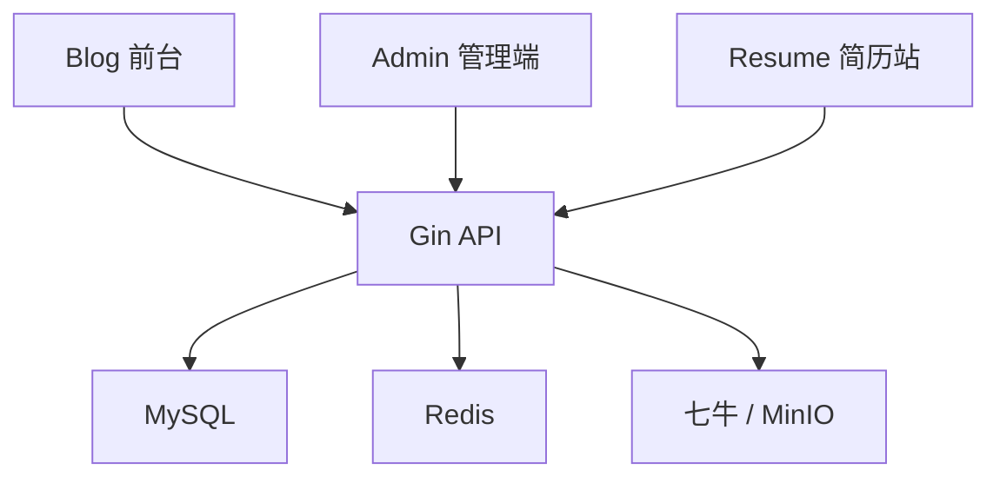
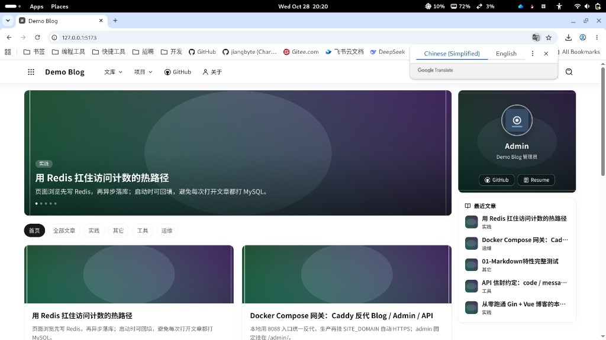
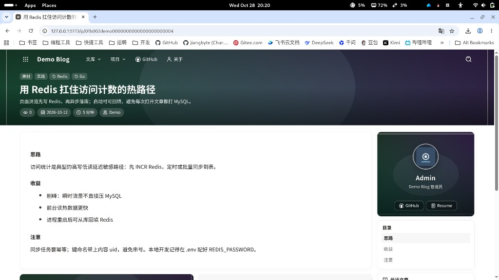
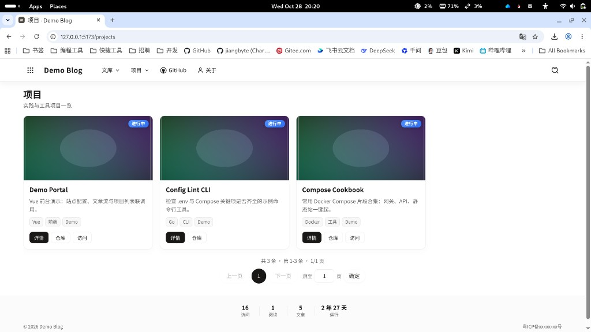
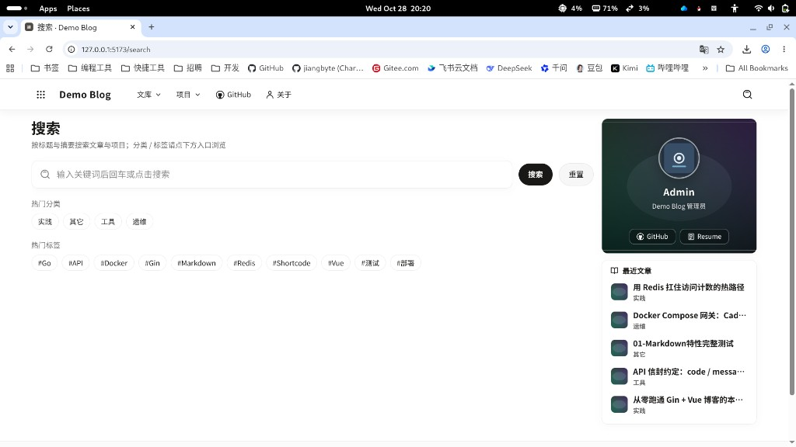
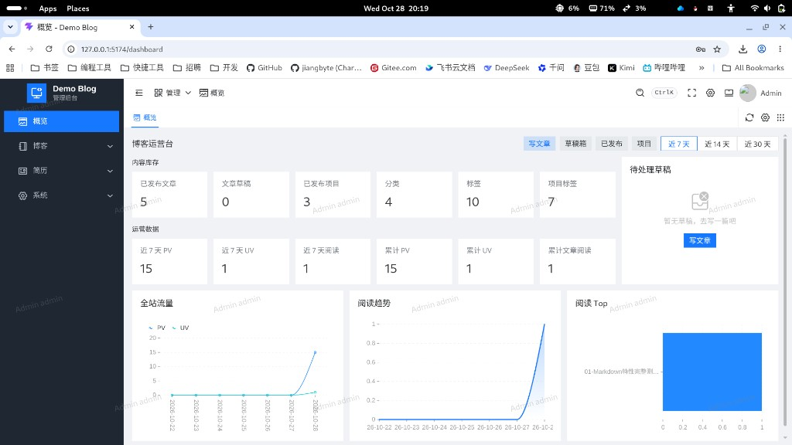
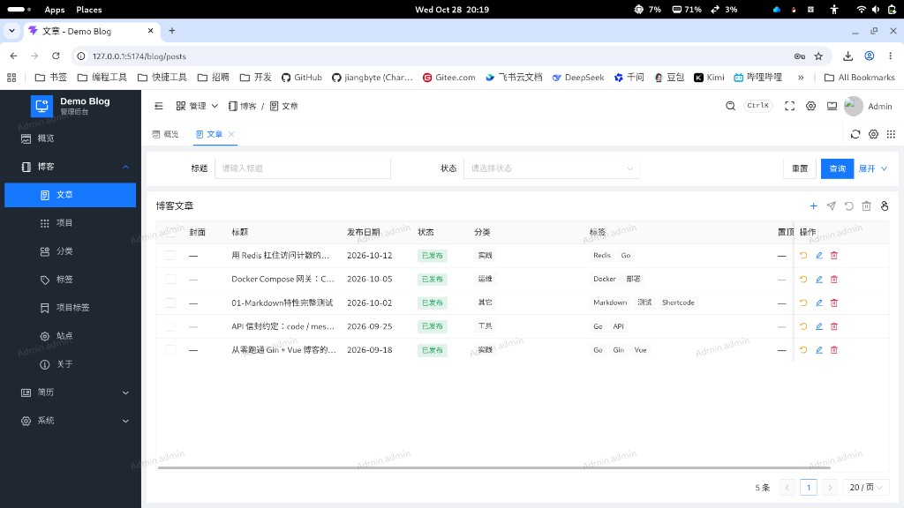
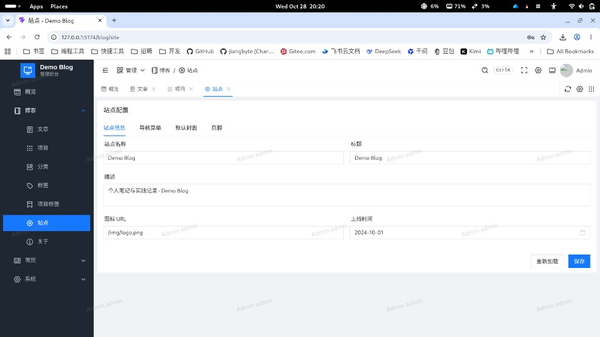
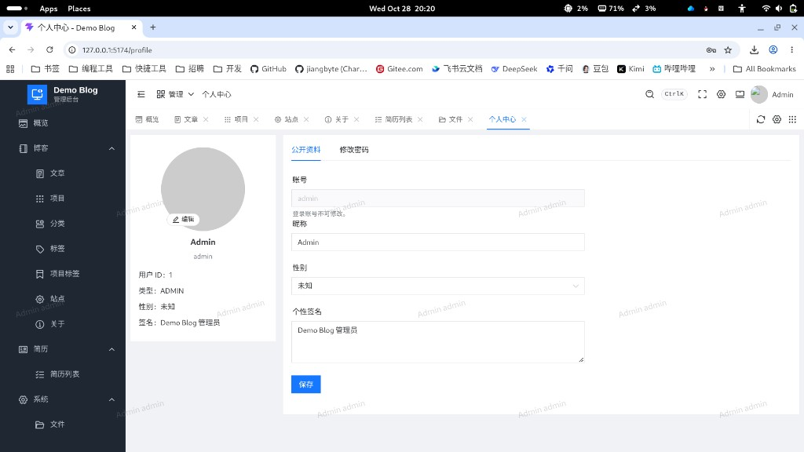
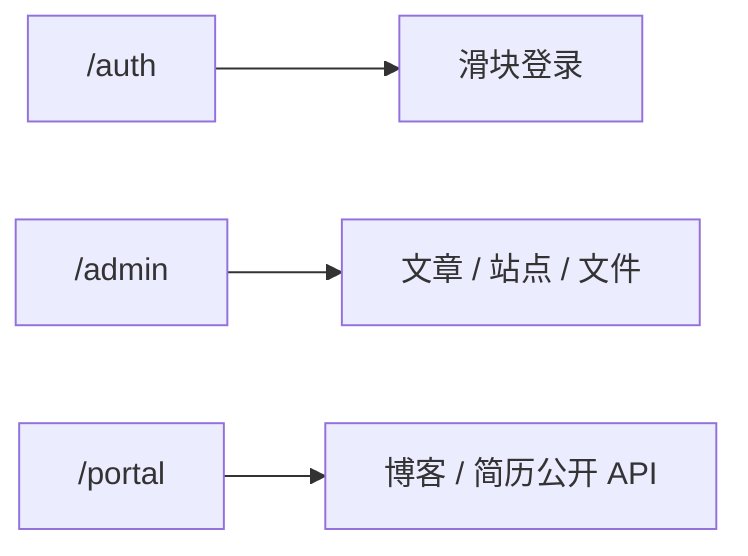

- 仓库：<https://github.com/jiangfolio/go-blog>
- Release：<https://github.com/jiangfolio/go-blog/releases/tag/v1.0.0>

**go-blog** 是个人博客全栈系统：后端 Go（Gin + GORM + Redis），前端含博客前台、管理端与简历站。单管理员模型，Docker Compose + Caddy 可部署。MIT。

因为懒得维护动态博客——既不如静态站点用 Markdown 编写方便，也不便备份——所以把之前自己做的博客系统整理出来并开源了。相对「纯静态站」，文章、项目、简历与文件管理走同一套 API；相对大型 CMS，不做多用户与角色树。

## 界面预览

### 前台

<table>
  <tr>
    <td width="50%"></td>
    <td width="50%"></td>
  </tr>
  <tr>
    <td align="center">首页</td>
    <td align="center">文章详情</td>
  </tr>
  <tr>
    <td width="50%"></td>
    <td width="50%"></td>
  </tr>
  <tr>
    <td align="center">项目</td>
    <td align="center">搜索</td>
  </tr>
</table>

### 管理端

<table>
  <tr>
    <td width="50%"></td>
    <td width="50%"></td>
  </tr>
  <tr>
    <td align="center">概览</td>
    <td align="center">文章管理</td>
  </tr>
  <tr>
    <td width="50%"></td>
    <td width="50%"></td>
  </tr>
  <tr>
    <td align="center">站点配置</td>
    <td align="center">个人中心</td>
  </tr>
</table>

## 特性

- **内容**：文章 / 分类 / 标签、项目、归档、搜索、关于页
- **管理端**：Markdown 编辑、站点配置、文件管理（默认七牛 Kodo，可切 MinIO）
- **简历**：管理端编辑 + 公开 HTML / PDF（PDF 依赖 Chromium）
- **鉴权**：滑块验证码登录；单管理员，登录即全权限
- **约定**：路径 `/auth` · `/admin/...` · `/portal/...`；仅 GET / POST；JSON `snake_case`；信封 `{ code, message, data }`（成功 `0000`）
- **运维**：sitemap；可选 IndexNow；`jb-md` Markdown 上传 CLI；Caddy 网关 · Docker Compose

## 技术栈

- API：Go 1.22+ · Gin · GORM · Redis
- 前台：Vue 3 · Vite · Tailwind
- 管理端：Vue 3 · Vite · Naive UI
- 简历站：Vue 3 · Vite
- 存储：七牛 Kodo（可切 MinIO）
- 部署：Docker Compose · Caddy
