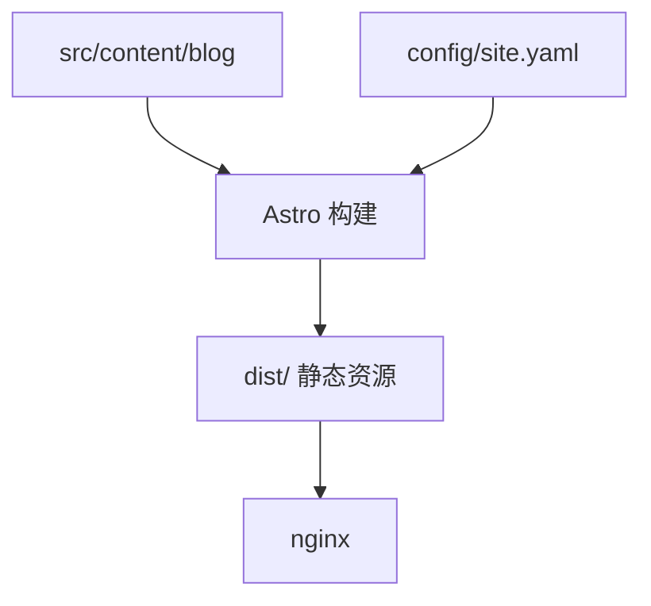

- 仓库：<https://github.com/jiangbyte/jiangbyte-blog>
- 主页：<https://jiangbyte.cn>

**jiangbyte-blog**（摸鱼猫泡泡）是基于 [astro-koharu](https://github.com/cosZone/astro-koharu) 的个人站点 fork：Astro 7 + React + Tailwind，内容以 Markdown / MDX 为主，站点工程与文档同仓。旧版 VuePress + Theme Hope 站归档在 `vuepress2` 分支。

相对「只改文章的主题博客」，本仓把配置、系列页、写作室与落款等都收进同一套 `config/site.yaml` + Content Collections；构建为纯静态站点，本地 `pnpm run deploy` 经 rsync 发布到 nginx。

## 界面预览

## 特性

- **内容体系**：分类 / 标签 / 归档；项目集、软考、源码阅读等 Featured Series；Pagefind 全站搜索
- **Markdown 增强**：Shoka 风格容器与特效、Mermaid、KaTeX、加密块、OG / 外链预览；可选信息图（AntV Infographic）
- **写作与落款**：公开写作室 `/editor`；文章源码以 `.md` 端点导出；复制 / 下载 / 在写作室打开；落款（执笔方式、阅读提示）可配置
- **外观与形象**：Soft Ice 主题与本地 ACG 封面池；站点拟人 Claire（泡泡）设定页
- **工程**：`site.yaml` 归一化配置；Biome + node:test；Koharu CLI（backup / migrate / generate）；双许可（文档 CC BY-NC 4.0，源码 AGPL-3.0）

## 技术栈

- 框架：Astro 7 · React · Tailwind CSS 4
- 内容：Astro Content Collections · Pagefind
- 交互 / 状态：Motion · Nanostores · Radix UI
- 工具链：pnpm · Biome · Koharu CLI · rsync 部署
