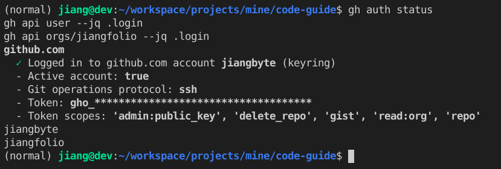
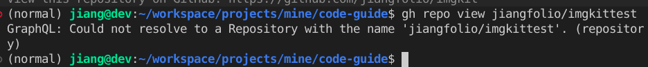

个人账号 [`jiangbyte`](https://github.com/jiangbyte) 下面堆的仓库越来越多：实验草稿、学习笔记、半成品和真正能给人用的工具混在一起。别人点开 profile，很难一眼分清「哪些值得看」。

于是建了组织 [`jiangfolio`](https://github.com/jiangfolio)，把相对成型的开源项目迁过去；个人账号继续放杂项。

## 为什么要建组织

动机很简单，就三点：

1. **对外叙事更干净**  
   组织像一个「开源橱窗」：进来看到的是产品/工具，而不是个人试验田。个人 README 里也可以写清楚：成型的在组织，个人仓比较杂。

2. **权限与协作更自然**  
   以后若有协作、CI、Pages、讨论区，挂在组织下比挂在个人名下更好扩。即便现在还是我一个人推，边界先划好。

3. **命名空间稳定**  
   `jiangfolio/imgkit` 比跟着个人账号一辈子绑死更合适。个人账号以后改名、归档、分流都不会牵着这些仓走。


## 迁了哪些仓库

这一批从 `jiangbyte/*` Transfer 到 `jiangfolio/*` 的有：

| 仓库 | 大致定位 |
|------|----------|
| [imgkit](https://github.com/jiangfolio/imgkit) | 即时图像处理小工具（Favicon / 压缩 / 缩放等） |
| [xuanjian](https://github.com/jiangfolio/xuanjian) | Agent 运维桌面端 |
| [acoj](https://github.com/jiangfolio/acoj) | 在线评测 / OJ |
| [SparkSandbox](https://github.com/jiangfolio/SparkSandbox) | 隔离执行用户代码的 HTTP 服务 |
| [M3u8Downloader](https://github.com/jiangfolio/M3u8Downloader) | 跨平台 m3u8 下载器 |
| [ResumeFloat](https://github.com/jiangfolio/ResumeFloat) | 置顶悬浮简历速拷 |

## 迁移怎么做

GitHub 的 **Transfer** 会保留 stars、issues、提交历史；旧 URL 自动 301 到新地址。比「新建空仓再 push」干净。

但是前提：

- 已登录有权限的账号（我对 `jiangfolio` 是 admin）
- 本机装好 [`gh`](https://cli.github.com/)，且 `gh auth status` 正常
- Token 带 `repo`（以及能操作目标组织）

### 1. 确认源仓与组织

```bash
gh auth status
gh api user --jq .login
gh api orgs/jiangfolio --jq .login
gh repo view jiangbyte/imgkit --json name,owner,url,isPrivate
```



确认组织里还没有同名仓，避免冲突：

```bash
gh repo view jiangfolio/imgkit   # 应报找不到
```



### 2. 发起 Transfer

以 `imgkit` 为例：

```bash
gh api repos/jiangbyte/imgkit/transfer \
  -f new_owner=jiangfolio \
  -f new_name=imgkit
```

`new_name` 可省略（默认沿用原名）。批量时循环即可：

```bash
for repo in SparkSandbox acoj xuanjian M3u8Downloader ResumeFloat; do
  gh api "repos/jiangbyte/${repo}/transfer" -f new_owner=jiangfolio >/dev/null \
    && echo "${repo} OK"
done
```

Transfer 接口返回时，`full_name` 有时仍显示旧 owner，稍等几秒再查：

```bash
gh api repos/jiangfolio/imgkit --jq '{full_name,html_url,owner:.owner.login}'
```

看到 `jiangfolio/imgkit` 即成功。旧地址 `github.com/jiangbyte/imgkit` 会跳到组织仓。

### 3. 本地克隆改 remote

若本机还有旧 clone：

```bash
cd /path/to/imgkit
git remote set-url origin git@github.com:jiangfolio/imgkit.git
git remote -v
git fetch origin
```
